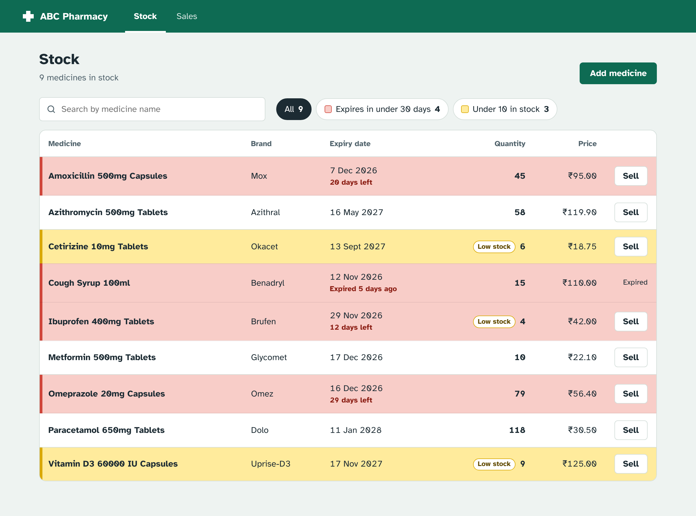
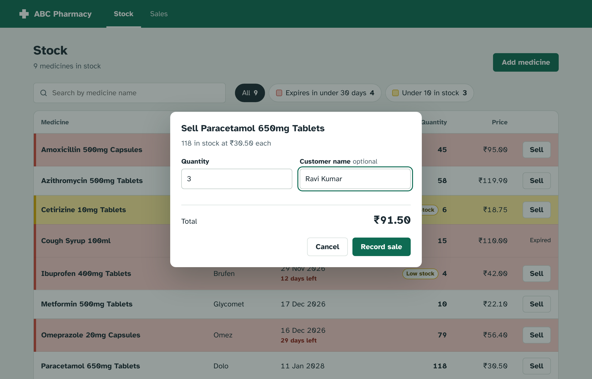
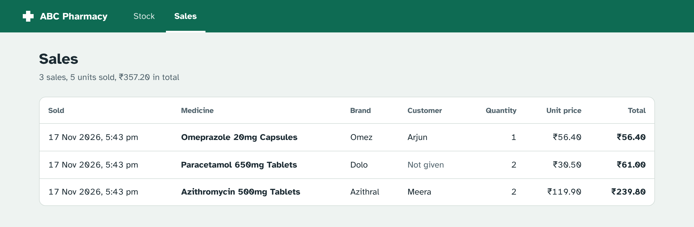

# ABC Pharmacy: Medicine Stock & Sales

A single-page application for ABC Pharmacy to keep track of medicines and record sales.
The back end is an **ASP.NET Core 8 Web API** that stores data in **JSON files on the server**. The front end is a
**plain JavaScript (ES modules) SPA** that the same app serves, so nothing needs installing apart from the .NET SDK.



| Recording a sale | Sales history |
|---|---|
|  |  |

---

## How to run

**Prerequisite:** [.NET 8 SDK](https://dotnet.microsoft.com/download/dotnet/8.0) or later. (The project rolls forward, so it also runs on .NET 9 or 10.)

```bash
dotnet run --project src/AbcPharmacy.Api
```

Then open **http://localhost:5000**.

| URL | What it is |
|---|---|
| http://localhost:5000 | The application (single page) |
| http://localhost:5000/swagger | Interactive API documentation (Development environment) |

On first run, 9 sample medicines are created in `src/AbcPharmacy.Api/App_Data/medicines.json`. Their expiry dates are
relative to *today*, so the red and yellow highlighting always shows, whenever the app is run. To reset the data, stop the app and delete the `App_Data` folder.

**Online IDE / "Open Preview":** if the preview cannot reach `localhost`, bind to all interfaces:

```bash
dotnet run --project src/AbcPharmacy.Api --urls http://0.0.0.0:5000
```

All front-end URLs are relative, so the app also works behind a preview proxy that serves it from a sub-path.

### Run the tests

```bash
dotnet test
```

38 unit tests cover the colour rules at their exact boundaries, adding medicines, sales and stock reduction,
**concurrent sales never overselling**, JSON storage safety, and validation.

---

## Requirements coverage

| Requirement | Where / how |
|---|---|
| Medicine attributes: full name, notes, expiry date, quantity, price (2 dp), brand | `Models/Medicine.cs`; price is validated to max 2 decimal places and always stored with 2 (e.g. `64.50`) |
| View list of medicines in a grid, **excluding Notes** | Stock page grid. Notes are shown when you click a medicine's name (details dialog) |
| **Red** background when expiry date is less than 30 days away | `InventoryRules.IsExpiringSoon`; already-expired medicines are red too |
| **Yellow** background when quantity is less than 10 | `InventoryRules.IsLowStock` |
| Add medicine details | "Add medicine" dialog → `POST /api/medicines` |
| Maintain sale records | "Sell" button on each row → `POST /api/sales`; stock is reduced; history on the Sales page |
| Search by medicine name *(good to have)* | Search box, server-side, case-insensitive, partial match → `GET /api/medicines?search=` |
| .NET Core API | ASP.NET Core 8, controllers |
| JavaScript framework of choice | Vanilla JavaScript ES modules (see *Design decisions*) |
| Data stored as JSON on the server | `App_Data/medicines.json`, `App_Data/sales.json` |

---

## API

| Method | Route | Description | Responses |
|---|---|---|---|
| GET | `/api/medicines?search={text}` | List medicines (optionally filtered by name), with computed `isExpiringSoon`, `isLowStock`, `isExpired`, `daysToExpiry` | 200 |
| GET | `/api/medicines/{id}` | One medicine | 200, 404 |
| POST | `/api/medicines` | Add a medicine | 201, 400 (validation), 422 (expiry in the past) |
| GET | `/api/sales` | All sales, newest first | 200 |
| GET | `/api/sales/{id}` | One sale | 200, 404 |
| POST | `/api/sales` | Record a sale and reduce stock | 201, 400, 404, 422 (not enough stock / expired) |

Errors use the standard **RFC 7807 ProblemDetails** format, e.g.

```json
{ "status": 422, "title": "Request cannot be processed", "detail": "Only 4 unit(s) of 'Ibuprofen 400mg Tablets' in stock; cannot sell 5." }
```

Example request body for `POST /api/medicines`:

```json
{ "fullName": "Paracetamol 650mg Tablets", "brand": "Dolo", "expiryDate": "2027-06-30",
  "quantity": 120, "price": 30.50, "notes": "Strip of 15" }
```

---

## Project structure

```
AbcPharmacy.sln
src/AbcPharmacy.Api/
├── Controllers/        MedicinesController, SalesController (thin; HTTP only)
├── Contracts/          Request/response DTOs with validation attributes
├── Models/             Medicine, Sale (what is stored in JSON)
├── Services/           MedicineService, SaleService, InventoryRules (business logic)
├── Data/               JsonFileStore<T> (file I/O + locking), repositories, sample data seeder
├── Infrastructure/     Global exception handler, custom exceptions, validation attribute, Money helper
├── Options/            Strongly typed settings (thresholds, data folder)
├── wwwroot/            The SPA: index.html, css/, js/ (api, format, ui, stock, sales, app), fonts/
├── App_Data/           medicines.json, sales.json (created at runtime)
└── Program.cs          Dependency injection and middleware pipeline
tests/AbcPharmacy.Tests/  xUnit tests
```

Layering: **Controller → Service → Repository → JsonFileStore**. Each layer depends only on the one below it through an interface.

---

## Design decisions

**Business rules live on the server.** The API returns `isExpiringSoon`, `isLowStock` and `daysToExpiry` with each
medicine. The browser only maps those flags to colours. That keeps the rule in one tested place (`InventoryRules`)
and avoids differences between the server's and the browser's clock or time zone.

**Rule thresholds are configuration.** `30` days and `10` units live in `appsettings.json` (`Inventory` section),
so the pharmacy can change them without a code change.

**When a medicine is both expiring and low on stock, red wins.** Expiry is the safety issue: it decides whether the medicine
can be sold at all. The row is red, and a "Low stock" tag in the quantity cell keeps the second fact visible.
Status is never shown by colour alone. There is always a text label too ("12 days left", "Low stock"), for colour-blind users.

**JSON storage is safe under concurrent requests.** `JsonFileStore<T>` is a singleton per file and wraps every
read-modify-write in a `SemaphoreSlim`, so two requests can never overwrite each other's changes. Writes go to a temp file
that then replaces the real file, so a crash mid-write can't corrupt the data. A test fires 25 simultaneous sales at
10 units of stock and checks that exactly 10 succeed.

**Selling is check-and-reduce in one atomic step.** The "is there enough stock?" check runs *inside* the store's lock,
together with the decrement. Checking first and updating later would let two sales both pass the check and oversell.

**Sales are snapshots.** Each sale stores the medicine name, brand and unit price *at the time of sale*, so the history
stays correct if a price changes later. Totals are rounded to 2 dp with `decimal` (never `double`) to avoid floating-point errors.

**Two JSON files can't share a transaction**, so if writing the sale fails after stock was reduced, `SaleService`
puts the stock back (a compensating action) and logs the error.

**Validation happens in two layers.** Format rules (required fields, ranges, max 2 decimal places) are data annotations
on the request DTOs and are enforced automatically by `[ApiController]` (400). Rules that need business context
(expiry not in the past, enough stock, not expired) live in the services (422). The front end repeats the format checks for
instant feedback and also shows any server errors next to the right field.

**Errors are handled in one place.** `GlobalExceptionHandler` (`IExceptionHandler`, .NET 8) maps `NotFoundException` → 404,
`BusinessRuleException` → 422, anything else → 500 with a generic message (details are logged, not leaked).

**"Today" is injectable.** Services use .NET 8's `TimeProvider` instead of `DateTime.Now`, so tests can pin the date and
check the 29/30-day and 9/10-unit boundaries exactly.

**The front end is vanilla JavaScript with no build step.** The brief allows any framework. With only two views, plain ES modules
keep the submission dependency-free: no `npm install` and no bundler, and it runs anywhere the API runs. The code is still
split by responsibility (`api.js`, `stock.js`, `sales.js`, `ui.js`, `format.js`) with a small hash router (`#/stock`, `#/sales`).
It would port directly to React or Angular components if the app grew.

**Front-end safety and usability.** All user-entered text is HTML-escaped before rendering (prevents XSS). Search is debounced
and ignores out-of-order responses. Dialogs use the native `<dialog>` element (keyboard and Escape support). Focus is visible,
and the layout works on mobile (the grid scrolls sideways). The font, Atkinson Hyperlegible, was designed for legibility and
keeps look-alike characters (0/O, 1/l/I) distinct, which helps when reading doses. It is bundled locally, so no CDN is needed.

## Assumptions

- "Expiry date less than 30 days" means fewer than 30 days from today, including medicines that have already expired.
- Expired medicines cannot be sold. Medicines that are only expiring soon can be.
- A new medicine's expiry date cannot be in the past. A quantity of 0 is allowed when adding (e.g. stock on order).
- Prices are shown in Indian rupees (₹). Change `LOCALE`/`CURRENCY` in `wwwroot/js/format.js` for another currency.
- No authentication was requested, so none was added.

## With more time

- Replace JSON files with a database (EF Core + SQL Server/SQLite). Only the repository classes would change.
- Edit/delete medicines, restock, and batch/lot numbers (the same medicine often has several expiry dates).
- Authentication and roles (pharmacist vs. cashier), plus an audit trail.
- Paging and sorting for large inventories. Sales reports by date range.
- Integration tests with `WebApplicationFactory`, a Dockerfile, and a CI pipeline (GitHub Actions).
